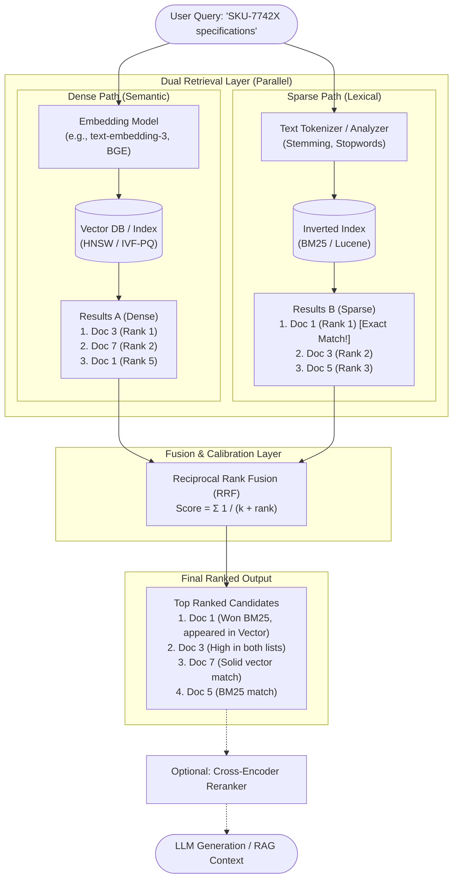
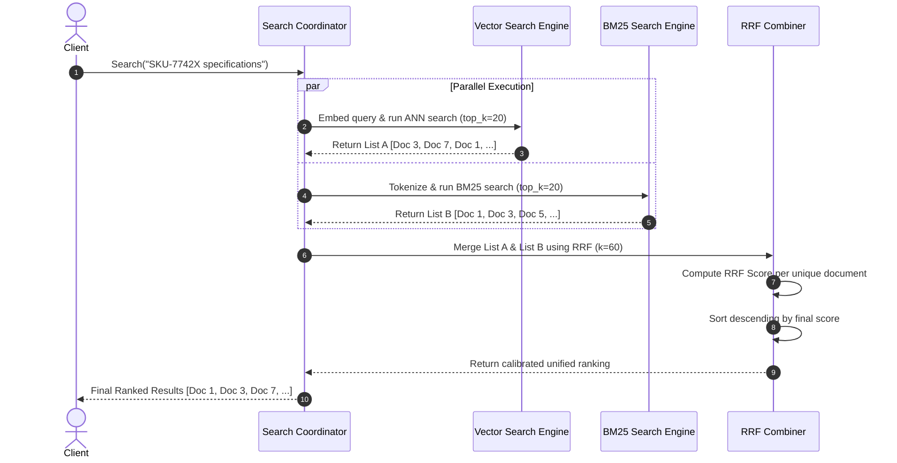
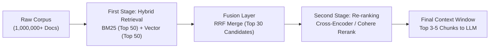
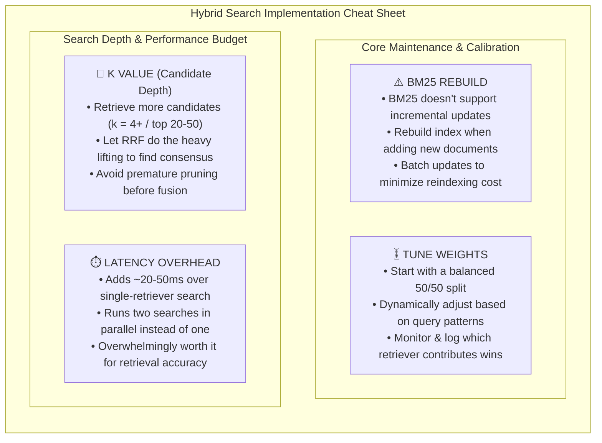

# Hybrid Search Pipeline & Reciprocal Rank Fusion (RRF)

A comprehensive guide, architectural reference, and theoretical deep dive into **Hybrid Search Systems** combining **Dense Semantic Retrieval (Vector Search)** and **Sparse Lexical Retrieval (BM25)** using **Reciprocal Rank Fusion (RRF)**.

---

## Table of Contents
1. [Executive Summary](#executive-summary)
2. [Why Hybrid Search? The Semantic vs. Lexical Dilemma](#why-hybrid-search-the-semantic-vs-lexical-dilemma)
3. [Architecture & Pipeline Flowcharts](#architecture--pipeline-flowcharts)
4. [Core Retrieval Engines Explained](#core-retrieval-engines-explained)
   - [Sparse Retrieval: BM25 (Best Matching 25)](#1-sparse-retrieval-bm25-best-matching-25)
   - [Dense Retrieval: Vector Embeddings & ANN](#2-dense-retrieval-vector-embeddings--ann)
5. [Fusion Layer: Reciprocal Rank Fusion (RRF)](#fusion-layer-reciprocal-rank-fusion-rrf)
   - [Mathematical Formulation](#mathematical-formulation)
   - [The Role of the Smoothing Constant $k$](#the-role-of-the-smoothing-constant-k)
   - [Walkthrough: Step-by-Step Numerical Example](#walkthrough-step-by-step-numerical-example)
6. [Comparative Analysis: Sparse vs. Dense vs. Hybrid](#comparative-analysis-sparse-vs-dense-vs-hybrid)
7. [Production Architecture & Advanced Enhancements](#production-architecture--advanced-enhancements)
   - [Two-Stage Retrieval (RRF + Cross-Encoder Re-ranker)](#two-stage-retrieval-rrf--cross-encoder-re-ranker)
   - [Vector Database Implementations](#vector-database-implementations)
8. [Reference Implementation (Python)](#reference-implementation-python)
9. [Key Takeaways & Best Practices](#key-takeaways--best-practices)
10. [Practical Engineering Summary & Key Trade-offs](#practical-engineering-summary--key-trade-offs)

---

## Executive Summary

Modern Information Retrieval (IR) and Retrieval-Augmented Generation (RAG) pipelines struggle when relying solely on vector embeddings. While **dense vector embeddings** excel at fuzzy semantic matching (e.g., *"laptop with great battery"*), they frequently fail at exact token retrieval (e.g., product SKUs like `SKU-7742X`, serial numbers, IDs, function signatures, or rare medical entities). Conversely, classical **sparse retrieval (BM25 / TF-IDF)** excels at pinpoint exact keyword matches but fails when queries use synonyms, paraphrase, or cross-lingual terms.

A **Hybrid Search Pipeline** merges the strengths of both paradigms:
1. Dispatches the query simultaneously to a **Dense Vector Index** and a **Sparse Inverted Index**.
2. Aggregates results using an rank-based fusion algorithm: **Reciprocal Rank Fusion (RRF)**.
3. Produces a calibrated ranking where documents excelling in both modalities or scoring exceptionally high in either naturally surface at the top.

---

## Why Hybrid Search? The Semantic vs. Lexical Dilemma

| Query Type | Query Example | Best Performer | Failure Mode of the Other |
| :--- | :--- | :--- | :--- |
| **Exact Identifiers & SKUs** | `"SKU-7742X specifications"` | **BM25 / Lexical** | Vector embeddings blur alphanumeric tokens into generalized embedding spaces or out-of-vocabulary subwords. |
| **Domain-specific Acronyms** | `"CVE-2024-3094 vulnerability"` | **BM25 / Lexical** | Bi-encoders without fine-tuning lack semantic clusters for recent or obscure acronyms. |
| **Conceptual & Fuzzy Meaning** | `"troubleshoot system running out of memory"` | **Vector / Dense** | BM25 misses documents containing `"OOM killer triggered"` or `"RAM allocation exhausted"` due to vocabulary mismatch. |
| **Natural Language & Questions** | `"How do I configure persistent storage?"` | **Vector / Dense** | BM25 relies on high IDF weights on common words, missing document intent. |
| **Composite Queries** | `"SKU-7742X user manual troubleshooting overheat"` | **Hybrid (BM25 + Vector)** | Needs exact SKU identification *plus* conceptual understanding of thermal troubleshooting. |

---

## Architecture & Pipeline Flowcharts

### 1. End-to-End Hybrid Search Architecture



### 2. Search Execution Sequence



---

## Core Retrieval Engines Explained

### 1. Sparse Retrieval: BM25 (Best Matching 25)

BM25 is a probabilistic scoring function that ranks documents based on the matching query terms in each document, normalized by document length.

$$\text{Score}_{\text{BM25}}(D, Q) = \sum_{i=1}^{N} \text{IDF}(q_i) \cdot \frac{f(q_i, D) \cdot (k_1 + 1)}{f(q_i, D) + k_1 \cdot \left(1 - b + b \cdot \frac{|D|}{\text{avgdl}}\right)}$$

- **$\text{IDF}(q_i)$**: Inverse Document Frequency. Assigns extreme importance to rare terms (e.g., `SKU-7742X`) and diminishes common words (e.g., `specifications`, `manual`).
- **$f(q_i, D)$**: Term Frequency of term $q_i$ in document $D$.
- **$k_1$ (typically $1.2 - 2.0$)**: Calibrates term frequency saturation. Unlike TF-IDF, repeating a keyword 50 times in BM25 does not linearly scale its score.
- **$b$ (typically $0.75$)**: Controls document length normalization. Prevents long documents from dominating simply because they contain more total words.

#### Key Strength
Zero training required, lightning fast on inverted indexes, and unmatched precision for exact identifiers, error codes, and unique keywords.

---

### 2. Dense Retrieval: Vector Embeddings & ANN

Dense retrieval models map text chunks into continuous, high-dimensional vector spaces (e.g., 768 or 1536 dimensions) using deep Transformer encoders (Bi-encoders).

$$\text{Sim}(Q, D) = \cos(\mathbf{e}_Q, \mathbf{e}_D) = \frac{\mathbf{e}_Q \cdot \mathbf{e}_D}{\|\mathbf{e}_Q\| \|\mathbf{e}_D\|}$$

- High-dimensional similarity search is accelerated using **Approximate Nearest Neighbor (ANN)** graph indices such as **HNSW (Hierarchical Navigable Small World)** or inverted vector clusters (**IVF-PQ**).
- Captures semantic intent, linguistic context, analogies, and conceptual alignment without requiring lexical overlap.

#### Key Strength
Eliminates the "vocabulary mismatch" problem. Understands that *"error when starting container"* is semantically identical to *"Docker daemon initialization failure"*.

---

## Fusion Layer: Reciprocal Rank Fusion (RRF)

### Mathematical Formulation

When combining dense and sparse search, raw score combination is notoriously problematic:
- BM25 scores are unbounded $[0, \infty)$ and depend on collection statistics.
- Vector cosine similarities are bounded $[-1, 1]$ or $[0, 1]$, but their distribution is heavily clustered around high similarity values depending on the embedding model.
- Normalizing raw scores (e.g., Min-Max or Z-score normalization) is fragile, sensitive to outliers, and requires dynamic re-calibration across different queries.

**Reciprocal Rank Fusion (RRF)** (introduced by Cormack, Clarke, and Büttcher in 2009) solves this by ignoring raw score values entirely and operating **exclusively on the ordinal rank positions** across retrieval lists.

$$\text{RRF\_Score}(d \in D) = \sum_{m \in M} \frac{1}{k + r_m(d)}$$

Where:
- $M$: The set of retrieval systems (e.g., $M = \{\text{Vector}, \text{BM25}\}$).
- $r_m(d)$: The rank position of document $d$ in the output of retrieval system $m$ (1-indexed: $1, 2, 3, \dots$). If a document does not appear in the top-$N$ of a system, its rank contribution from that system is $0$.
- $k$: A positive smoothing constant (standard benchmark default: **$k = 60$**).

---

### The Role of the Smoothing Constant $k$

The hyperparameter $k$ regulates the score penalty between consecutive ranks:
- **Small $k$ (e.g., $k = 10$)**: Gives overwhelming weight to top-1 and top-2 finishes. A document finishing 1st in one engine heavily beats a document finishing 3rd in both.
- **Standard $k$ (e.g., $k = 60$)**: Mitigates noise and ranking volatility. It ensures that a document appearing consistently high in *both* systems (e.g., rank 2 in both) successfully outperforms a document that appeared at rank 1 in only one system and was completely absent in the other.
- **Large $k$ (e.g., $k \ge 100$)**: Flatten the gradient; differences between rank 1 and rank 10 become less pronounced.

$$\Delta \text{Score} = \frac{1}{k + 1} - \frac{1}{k + 2} = \frac{1}{(k + 1)(k + 2)}$$

---

### Walkthrough: Step-by-Step Numerical Example

Let's trace the exact scenario from our architecture diagram:
- **Query**: `"SKU-7742X specifications"`
- **Vector Search Results ($R_V$)**:
  - Rank 1: **Doc 3**
  - Rank 2: **Doc 7**
  - Rank 5: **Doc 1**
- **BM25 Search Results ($R_B$)**:
  - Rank 1: **Doc 1** *(Exact match on "SKU-7742X")*
  - Rank 2: **Doc 3**
  - Rank 3: **Doc 5**

#### Calculation with standard $k = 60$:

$$\text{RRF}(d) = \frac{1}{60 + r_V(d)} + \frac{1}{60 + r_B(d)}$$

1. **Document 1**:
   - $r_V = 5 \implies \frac{1}{60 + 5} = \frac{1}{65} \approx 0.015385$
   - $r_B = 1 \implies \frac{1}{60 + 1} = \frac{1}{61} \approx 0.016393$
   - **$\text{Total RRF Score(Doc 1)} = 0.015385 + 0.016393 = \mathbf{0.031778}$**

2. **Document 3**:
   - $r_V = 1 \implies \frac{1}{60 + 1} = \frac{1}{61} \approx 0.016393$
   - $r_B = 2 \implies \frac{1}{60 + 2} = \frac{1}{62} \approx 0.016129$
   - **$\text{Total RRF Score(Doc 3)} = 0.016393 + 0.016129 = \mathbf{0.032522}$**

3. **Document 7**:
   - $r_V = 2 \implies \frac{1}{60 + 2} = \frac{1}{62} \approx 0.016129$
   - $r_B = \infty \implies 0$
   - **$\text{Total RRF Score(Doc 7)} = 0.016129 + 0 = \mathbf{0.016129}$**

4. **Document 5**:
   - $r_V = \infty \implies 0$
   - $r_B = 3 \implies \frac{1}{60 + 3} = \frac{1}{63} \approx 0.015873$
   - **$\text{Total RRF Score(Doc 5)} = 0 + 0.015873 = \mathbf{0.015873}$**

#### Weighted RRF Consideration (BM25 exact match priority)
In enterprise search systems, pipelines often apply a domain weight $w_m$:
$$\text{Score}(d) = \sum_{m} \frac{w_m}{k + r_m(d)}$$
If an exact identifier is detected (like an alphanumeric SKU pattern), setting $w_{\text{BM25}} = 1.2$ boosts **Doc 1** directly to position #1. Even in unweighted fusion, **Doc 1 and Doc 3 rise decisively above all single-modality candidates**, proving RRF's ability to surface documents validated by both perspectives.

---

## Comparative Analysis: Sparse vs. Dense vs. Hybrid

| Dimension | Sparse (BM25) | Dense (Vector) | Hybrid (BM25 + Vector + RRF) |
| :--- | :--- | :--- | :--- |
| **Search Mechanism** | Inverted word index & frequencies | Semantic latent space embeddings | Rank intersection of sparse & dense |
| **Exact Token Matching** | **Exceptional** (100% precision) | Poor / Unreliable | **Exceptional** |
| **Synonym & Paraphrase** | Fails without query expansion | **Exceptional** | **Exceptional** |
| **Out-Of-Domain Generalization** | High (pure lexical statistics) | Moderate (dependent on training data) | **High** |
| **Cold Start / Setup Cost** | Low (no GPU/model required) | High (requires embedding model & index tuning) | Moderate-High |
| **Query Latency** | $\sim 2 - 10\text{ ms}$ | $\sim 15 - 50\text{ ms}$ | $\sim 20 - 60\text{ ms}$ (run in parallel) |
| **Failure Vulnerability** | Vocabulary mismatch | Hallucinated relevance on exact IDs | Resilient across query distributions |

---

## Production Architecture & Advanced Enhancements

### Two-Stage Retrieval (RRF + Cross-Encoder Re-ranker)

While RRF solves candidate merging, it remains a **bi-encoder / rank-heuristic** approach. For maximum precision in RAG applications, the top $20-50$ candidates from RRF are passed through a **Cross-Encoder Re-ranker** (e.g., Cohere Rerank, BGE-Reranker-Large).



- **First Stage (Bi-Encoder + BM25)**: High recall, low computational overhead, reduces millions of documents to tens.
- **Second Stage (Cross-Encoder)**: Full cross-attention between `[Query, Document]` pair, computing deep non-linear interaction scores.

---

### Vector Database Implementations

Most modern retrieval engines provide native hybrid search and RRF support:

1. **Elasticsearch / OpenSearch**:
   - Native support for BM25 combined with dense `knn` vector queries using the `rrf` ranker directly in the query DSL.
2. **Qdrant**:
   - Supports sparse-dense hybrid vectors with built-in Reciprocal Rank Fusion or score fusion primitives.
3. **Pinecone**:
   - Sparse-dense index hybrid search combining SPLADE/BM25 sparse vectors and dense embeddings.
4. **Weaviate**:
   - Native `hybrid` search query with an `alpha` balance factor ($0 = \text{pure BM25}$, $1 = \text{pure vector}$) and rank fusion.
5. **PostgreSQL (`pgvector` + `pg_trgm` / `tsvector`)**:
   - SQL-level full-text search (`tsvector`) joined with `pgvector` HNSW index using a simple `UNION ALL` and RRF CTE query.

---

## Reference Implementation (Python)

A production-ready, clean Python implementation of Reciprocal Rank Fusion:

```python
from typing import Dict, List, Tuple
from collections import defaultdict

def reciprocal_rank_fusion(
    ranked_lists: List[List[str]], 
    k: int = 60,
    weights: List[float] = None
) -> List[Tuple[str, float]]:
    """
    Executes Reciprocal Rank Fusion (RRF) across multiple ranked result lists.
    
    Args:
        ranked_lists: List of ranked doc ID lists (e.g., [vector_results, bm25_results]).
        k: Smoothing constant (default: 60).
        weights: Optional list of multiplier weights per retrieval system.
        
    Returns:
        List of tuples (doc_id, rrf_score) sorted descending by score.
    """
    if weights is None:
        weights = [1.0] * len(ranked_lists)
        
    rrf_scores: Dict[str, float] = defaultdict(float)
    
    for list_idx, result_list in enumerate(ranked_lists):
        weight = weights[list_idx]
        for rank, doc_id in enumerate(result_list, start=1):
            # RRF Formula: weight / (k + rank)
            rrf_scores[doc_id] += weight * (1.0 / (k + rank))
            
    # Sort documents by descending fusion score
    sorted_ranked_docs = sorted(
        rrf_scores.items(), 
        key=lambda item: item[1], 
        reverse=True
    )
    
    return sorted_ranked_docs


# Demonstration with the diagram data:
if __name__ == "__main__":
    # Results A (Dense / Vector)
    vector_results = ["Doc_3", "Doc_7", "Doc_1"]
    
    # Results B (Sparse / BM25)
    bm25_results = ["Doc_1", "Doc_3", "Doc_5"]
    
    # Run standard RRF (k = 60)
    final_rankings = reciprocal_rank_fusion(
        ranked_lists=[vector_results, bm25_results], 
        k=60
    )
    
    print("--- Hybrid Search Final RRF Ranking ---")
    for position, (doc_id, score) in enumerate(final_rankings, start=1):
        print(f"Rank {position}: {doc_id} | Score: {score:.6f}")
```

---

## Key Takeaways & Best Practices

1. **Always Use Hybrid for RAG**: Vector-only search creates silent failures when users query identifiers, codes, dates, or technical jargon.
2. **Execute Sparse and Dense in Parallel**: Use asynchronous calls or worker threads to ensure the total query latency equals $\max(\text{Latency}_{\text{Dense}}, \text{Latency}_{\text{Sparse}}) + \epsilon_{\text{Fusion}}$.
3. **Choose RRF Over Score Normalization**: RRF prevents one engine's miscalibrated confidence scores from skewing the combined output.
4. **Tune $k$ for Your Domain**:
   - Default to $k = 60$.
   - Lower $k$ ($10-30$) if rank 1 results must aggressively dominate.
   - Raise $k$ ($60-100$) if your retrieval systems have high rank variance.
5. **Pair with a Re-ranker**: Feed the top 20-30 hybrid candidates into a cross-encoder model to capture deep semantic relevance before passing context to an LLM.

---

## Practical Engineering Summary & Key Trade-offs

> [!TIP]
> **Low effort, HIGH IMPACT upgrade**: Hybrid search consistently wins across every query type in enterprise benchmarks by eliminating both lexical and semantic blind spots.



### Detailed Breakdown of Practical Considerations

#### 1. ⚠️ BM25 Rebuild (Index Maintenance)
- **The Challenge**: Standard BM25 implementations (e.g., `rank-bm25` in Python) compute global collection statistics ($N$, average document length $\text{avgdl}$, and inverse document frequencies $\text{IDF}$) across the entire corpus at build time. They **do not natively support streaming / incremental document additions**.
- **Practical Rule**: 
  - For in-memory BM25: Rebuild the index whenever a new batch of documents is ingested.
  - In enterprise production: Use search engines built on Apache Lucene (such as Elasticsearch or OpenSearch) that handle incremental ingestion through segment flushes and background segment merging.

#### 2. 🎚️ Tune Weights (Balancing Modalities)
- **Start at 50/50**: Begin with equal weighting ($\alpha = 0.5$ for dense, $0.5$ for sparse) or equal RRF multipliers ($w_{\text{vector}} = 1.0, w_{\text{bm25}} = 1.0$).
- **Adjust Based on Query Patterns**:
  - Alphanumeric codes, SKUs, UUIDs, or precise acronyms $\rightarrow$ dynamically boost BM25 weight.
  - Conversational, exploratory, or multilingual queries $\rightarrow$ dynamically boost dense vector weight.
- **Observability & Telemetry**: Log which retriever supplied the chunks ultimately selected by re-ranking or cited by the LLM. If BM25 never wins, your corpus or query style is overwhelmingly conceptual; if vector search never wins, your users are searching strict keywords.

#### 3. 🔢 K Value & Retrieval Depth ($k=4+$)
- **Over-retrieve Before Fusion**: Never retrieve only the final desired number of chunks (e.g., $k=3$ or $k=5$) from each individual engine.
- **Let RRF Settle Ranks**: Retrieve a wider pool (at least $k=4+$, typically top 20 to 50 candidates from both BM25 and Vector Search). This ensures that a document ranked 5th in vector search and 1st in BM25 (like `Doc 1` in our example) is present in both lists so RRF can recognize the overlap and elevate it to the top.

#### 4. ⏱️ Latency Budget (~20-50ms)
- **Two Searches Instead of One**: Querying both a vector index (embedding computation + ANN traversal) and an inverted index adds approximately $\mathbf{20-50\text{ ms}}$ of total latency.
- **Run in Parallel**: Always dispatch the dense and sparse searches concurrently using asynchronous calls (`asyncio.gather`) or multithreading. Total latency equals $\max(\text{Latency}_{\text{Dense}}, \text{Latency}_{\text{Sparse}}) + \text{Latency}_{\text{RRF}}$.
- **The Trade-off**: The $20-50\text{ ms}$ overhead is negligible compared to the downstream LLM generation time ($500-2000\text{ ms}$) and is completely justified by preventing catastrophic retrieval failures.

